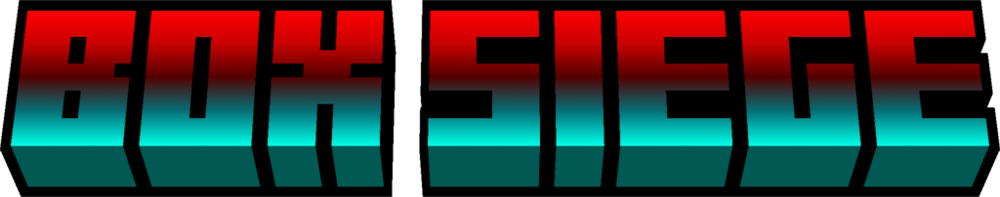

<div align="center">



# BOX SIEGE Website

**The Official Website for BOX SIEGE, a Local Multiplayer Box Brawler by Equinox Interactive**

[]()
[]()
[]()
[]()
[]()
[]()

[Visit Website](#) • [About](#about) • [Getting Started](#getting-started) • [Local Development](#local-development) • [Disclaimer](#disclaimer)

---

## About

BOX SIEGE Website is the official promotional and information website for BOX SIEGE, a chaotic local PvP brawler for 2-4 players with a 250-level solo campaign. The site introduces the game to new players and acts as a complete reference for everything inside it: every fighter, weapon, arena, power-up, campaign chapter, cosmetic item, and control scheme, all presented with the same arcade-style visual identity as the game itself.

Every page is built around the game's own art. Sprites, stage backdrops, power-up icons, music, and sound effects are all used directly on the site, and many of them are interactive: weapons can be test-fired, controls react to live key presses, and fighters can be previewed with their skins, KO poses, and voice lines. The site is fully responsive and works smoothly on desktop, tablet, and mobile.

The site also hosts the download hub for the game, with per-platform cards, system requirements, install steps, and a gameplay preview video.

---

## Getting Started

No installation is required to view the live site. Simply open the deployed URL in a browser. To run the project locally for development, see [Local Development](#local-development) below.

---

## Site Sections

BOX SIEGE Website is organized into the following pages, each accessible from the main navigation:

| Page | Description |
|---|---|
| Home | Landing page with the hero, gameplay highlights, a modes overview, an explore grid linking to every section, and a download call to action |
| Modes | Every way to play: local Versus, Team Battles, the 250-level Campaign, and the Shop, plus how a match flows from menu to fight |
| Fighters | All 24 fighters with skin previews, KO poses, and voice lines for every box |
| Arsenal | The four main weapons, the pistol, and the knife, with live stats, test firing, and 30 weapon skins |
| Arenas | All 10 mirrored arenas with their hazards, fall zones, and object density settings |
| Power-Ups | All 9 power-ups with their effects and durations, and how crate spawn rates are controlled |
| Campaign | The solo campaign: chapters, worlds, enemies, 50 bosses, 12 perks, and the scoring system |
| Match Rules | How Versus matches work: rounds to win, timer, team lanes, handicaps, and tie-breakers |
| Shop | The cosmetic shop and inventory: 240 fighter skins, 30 weapon skins, and 31 accessories across four rarities |
| Controls | Keyboard layouts for four players on one keyboard, controller mapping, and in-game settings |
| Download | Platform cards, system requirements, install steps, and a gameplay preview video |

An additional 404 page handles unknown routes.

---

## Core Features

| Feature | Description |
|---|---|
| Arcade Visual Identity | Consistent comic-style typography, skewed buttons, panels, and per-page accent colors drawn from the game |
| Animated Page Transitions | A striped slash wipes across the screen between pages with the BOX SIEGE logo, while the next page preloads under the cover |
| Interactive Previews | Test-fire weapons, preview fighter skins and accessories, and see keyboard keys light up as they are pressed |
| Soundtrack and Sound Effects | A built-in music player with four tracks (Main Menu, Campaign, Battle, Boss Fight), volume control, and a sound effects toggle |
| Themed Page Backdrops | Every page is dressed with the stage art of one of the game's arenas, with drifting box particles in the background |
| Game Status System | A single setting (`GAME_STATUS`) switches the whole site between "Beta" and "Released" wording, badges, buttons, and call to action text |
| Download Hub | Per-platform download cards for Windows, macOS, and Linux with direct downloads (.exe for Windows, .zip for macOS and Linux), system requirements, and install steps |
| Gameplay Preview Video | A configurable preview video that supports local files, YouTube, Google Drive, and direct video links |
| Responsive Layout | Optimized experience across desktop, tablet, and mobile, including a mobile navigation menu and safe-area support for notched devices |
| Accessibility | Reduced-motion support, keyboard focus management on page change, and descriptive labels on interactive controls |
| Route-Level Code Splitting | Every page except Home is its own chunk, preloaded during the page transition so the swap is instant |
| Self-Healing Deployments | If a visitor's open tab requests an outdated chunk after a new deploy, the site reloads once automatically instead of showing a broken page |
| Per-Page SEO | Individual page titles and meta descriptions, plus Open Graph and Twitter card tags |

---

## Game Content at a Glance

The site documents the following game content, all driven from structured data files:

| Content | Amount |
|---|---|
| Fighters | 24 (16 originals and 8 new faces) |
| Character Skins | 240 |
| Weapons | 6 (4 main weapons, a pistol, and a knife) |
| Weapon Skins | 30 |
| Accessories | 31 across four slots (head, face, neck, back) |
| Arenas | 10 mirrored stages with hazards |
| Power-Ups | 9 (7 in Versus, 2 exclusive to the Campaign) |
| Campaign | 250 levels, 5 chapters, 10 worlds, 50 bosses, 12 perks |
| Players | 2-4 on one screen, with keyboard and controller support |

---

## Data Sources

BOX SIEGE Website is fully static and does not depend on any external API or backend. All content is sourced from the following places:

| Source | Purpose |
|---|---|
| `src/data/generated.ts` | Game data extracted from the game's own scripts (characters, weapons, worlds, perks, skins, accessories, and more) |
| `src/data/game.ts` | Typed game data layer: weapons, arenas, power-ups, campaign structure, controls, links, download URLs, and game status |
| `src/data/pages.ts` | Page definitions: routes, labels, accent colors, teasers, facts, and meta descriptions |
| `src/data/modes.ts` | Content for the game modes section |
| `public/assets/` | All images, music, and sound effects used by the site |
| GitHub Releases | Hosts the downloadable game builds linked from the Download page |

---

## Technology

| Layer | Technology |
|---|---|
| Frontend Framework | React 19 with TypeScript |
| Routing | React Router 7 with lazy-loaded route chunks |
| Styling | Tailwind CSS 4 with custom CSS for the arcade design system |
| Animation | Framer Motion and the Web Animations API (GPU-accelerated page transitions) |
| Icons | Lucide React, plus inline SVG brand icons |
| Typography | Badaboom, Lilita One, and Digital-7, bundled with the app |
| Media | Native HTML audio for music and sound effects, WebP for all sprites and artwork |
| Build Tool | Vite 7 |
| Type Checking | TypeScript 5 in strict mode |
| Package Manager | pnpm |
| Asset Tooling | Python with Pillow (optional, maintainers only) |
| Hosting and Deployment | Vercel |

---

## Local Development

### Prerequisites

- Node.js (version 18 or later is recommended)
- [pnpm](https://pnpm.io/installation)

### Installation

```sh
git clone <this-repository-url>
cd box-siege-site
pnpm install
```

### Environment Variables

None. The site is fully static and requires no API keys or environment variables to run or build.

### Available Scripts

| Command | Description |
|---|---|
| `pnpm dev` | Starts the local development server on port 8080 |
| `pnpm build` | Type-checks the project and builds it for production into `dist` |
| `pnpm preview` | Serves the production build locally |

### Running the Project

```sh
pnpm dev
```

The site will be available locally once the development server starts, with the terminal output showing the exact local URL.

---

## Configuration

Most day-to-day changes only need a single line to be edited.

| Task | Where |
|---|---|
| Switch the site between "Beta" and "Released" | Change `GAME_STATUS` in `src/data/game.ts` (`"beta"` or `"released"`) |
| Update direct download links | Edit the `DOWNLOAD` object in `src/data/game.ts` |
| Change a platform's download link | Edit the `DOWNLOAD` object in `src/data/game.ts` (Windows = `.exe`, macOS and Linux = `.zip`) |
| Set the gameplay preview video | Change `PREVIEW_VIDEO` in `src/components/Trailer.tsx` (local file, YouTube, Google Drive, or direct link) |
| Update social links | Edit the `LINKS` object in `src/data/game.ts` |
| Add or edit a page | Edit `src/data/pages.ts` and the matching file in `src/pages/` |
| Change the music playlist | Edit `TRACKS` in `src/lib/audio.ts` and add files to `public/assets/music/` |

### Fonts

The three game fonts are stored as `.woff2` files in `src/assets/fonts/` and referenced with relative paths in `src/styles.css`. Vite bundles and fingerprints them at build time, so a missing font file fails the build instead of silently falling back in production. Avoid moving them to absolute `/assets/...` paths.

---

## Deployment

The project is configured for deployment on [Vercel](https://vercel.com), using Vite as the build framework and `dist` as the output directory. The included `vercel.json` rewrites client-side routes to `index.html` to support direct navigation and page refreshes, while leaving real files (such as fonts, images, and audio) untouched so missing assets return a proper 404. Files under `/assets/` are served with long-lived immutable cache headers.

---

</div>

## Project Structure

```
box-siege-site/
├── public/                     # Static assets served as-is
│   ├── favicon.png
│   └── assets/
│       ├── chars/              # Fighter sprites and KO poses
│       ├── skins/              # Character skins
│       ├── acc/                # Accessories
│       ├── guns/               # Weapon sprites per player color
│       ├── wskins/             # Weapon skins
│       ├── stages/             # Arena backdrops and floors
│       ├── pu/                 # Power-up icons
│       ├── camp/               # Campaign art (perks, bosses, stars)
│       ├── ui/                 # Logo, hearts, coins, and icons
│       ├── music/              # Soundtrack (.ogg)
│       └── sfx/                # Sound effects (.mp3)
├── src/
│   ├── assets/fonts/           # Bundled game fonts (.woff2)
│   ├── components/             # Layout, navigation, hero, transitions, cards, music player
│   ├── data/                   # Typed game data, page definitions, and generated content
│   ├── lib/                    # Shared utilities (audio engine)
│   ├── pages/                  # One file per route
│   ├── App.tsx                 # Router, lazy routes, and page transition engine
│   ├── main.tsx                # Application entry point
│   └── styles.css              # Tailwind setup, theme tokens, fonts, and custom styles
├── tools/                      # Optional Python scripts for asset conversion and data extraction
├── index.html                  # HTML shell, meta tags, and Open Graph tags
├── vite.config.ts              # Vite build configuration
├── vercel.json                 # Vercel rewrites and cache headers
└── tsconfig.json               # TypeScript configuration
```

The scripts in `tools/` are maintainer utilities used to convert the game's original sprites to WebP and to extract game data from its scripts into `src/data/generated.ts`. They expect the original game project at local paths and are not needed to run, build, or deploy the website.

---

<div align="center">

## Disclaimer

BOX SIEGE Website is the official website for BOX SIEGE by Equinox Interactive. The game is currently in beta, and the content, features, and download availability shown on this site may change before the full release. All game artwork, characters, music, and sound effects belong to their respective creators and are used here solely to present the game. Third-party names and logos (such as Windows, macOS, and Linux) belong to their respective owners.

---

*Built by Equinox Interactive.*

[Back to Top](#box-siege-website)

</div>